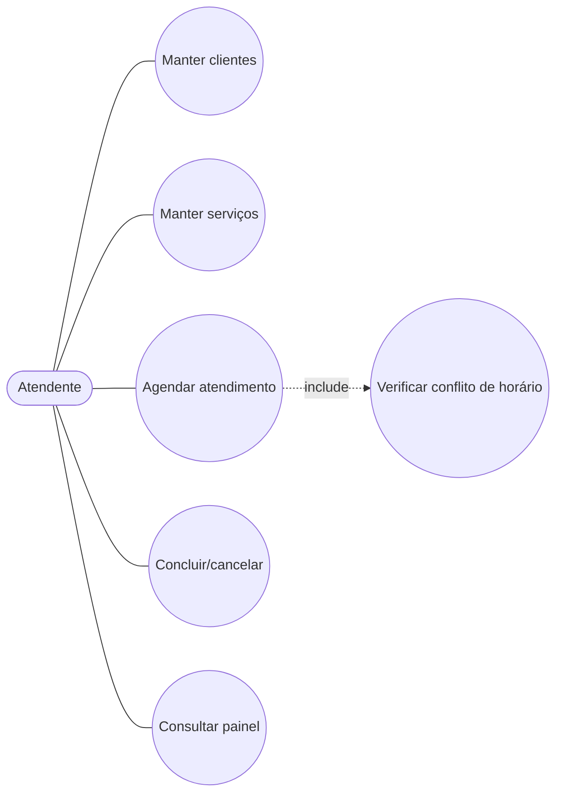

# 2. Requisitos e casos de uso

## 2.1 Requisitos funcionais

| ID | Requisito | Prioridade |
|---|---|---|
| RF01 | Cadastrar cliente com nome, telefone e e-mail (opcional) | Alta |
| RF02 | Editar, buscar (nome/telefone) e excluir cliente | Alta |
| RF03 | Cadastrar e editar serviço com nome, descrição, preço e duração | Alta |
| RF04 | Ativar e desativar serviço | Média |
| RF05 | Registrar agendamento (cliente + serviço + data/hora) | Alta |
| RF06 | Listar agendamentos com filtro por data e status | Alta |
| RF07 | Concluir ou cancelar agendamento | Alta |
| RF08 | Exibir painel do dia: total, em aberto, concluídos, faturado e previsto | Média |
| RF09 | Fazer backup (download em JSON) e restaurar os dados a partir do arquivo – *incluído na versão 1.1 a partir da validação com usuários* | Média |

## 2.2 Requisitos não funcionais

| ID | Requisito |
|---|---|
| RNF01 | Interface responsiva (largura mínima de 360 px) |
| RNF02 | Validação nos dois lados: navegador (HTML5/JS) e servidor (Model) |
| RNF03 | Mensagens de erro em português, claras e próximas do campo |
| RNF04 | Arquitetura MVC com Flask; código no GitHub |
| RNF05 | Cobertura das regras de negócio por testes automatizados |
| RNF06 | Banco relacional popular (SQLite; migrável para MySQL/PostgreSQL) |

## 2.3 Regras de negócio

| ID | Regra |
|---|---|
| RN01 | Nome do cliente com no mínimo 3 caracteres; telefone no formato brasileiro |
| RN02 | E-mail do cliente é único, quando informado |
| RN03 | Preço > 0; duração entre 5 e 480 minutos; nome do serviço único |
| RN04 | Agendamento apenas para data/hora futura |
| RN05 | Expediente de segunda a sábado, 08:00–18:00; o serviço precisa **terminar** até 18:00 |
| RN06 | Não pode haver dois agendamentos ativos cujos intervalos se sobreponham |
| RN07 | Apenas agendamentos com status AGENDADO podem ser concluídos ou cancelados |
| RN08 | Cliente com agendamentos não pode ser excluído |
| RN09 | Serviço inativo não aparece para novos agendamentos |

## 2.4 Diagrama de casos de uso

## 2.5 Caso de uso detalhado: UC3 – Agendar atendimento

| Campo | Descrição |
|---|---|
| Ator | Atendente |
| Pré-condição | Existir ao menos um cliente e um serviço ativo |
| Fluxo principal | 1. Atendente abre "Novo agendamento". 2. Seleciona cliente, serviço e data/hora. 3. Sistema valida RN04, RN05 e RN06. 4. Sistema grava com status AGENDADO e exibe "Agendamento realizado com sucesso". |
| Fluxo alternativo A1 | Horário em conflito → sistema exibe "Já existe um agendamento neste horário" e mantém os dados digitados. |
| Fluxo alternativo A2 | Fora do expediente ou domingo → mensagem específica. |
| Fluxo alternativo A3 | Sem cliente ou serviço cadastrado → tela orienta a cadastrar primeiro. |
| Pós-condição | Horário reservado e visível no painel do dia |
