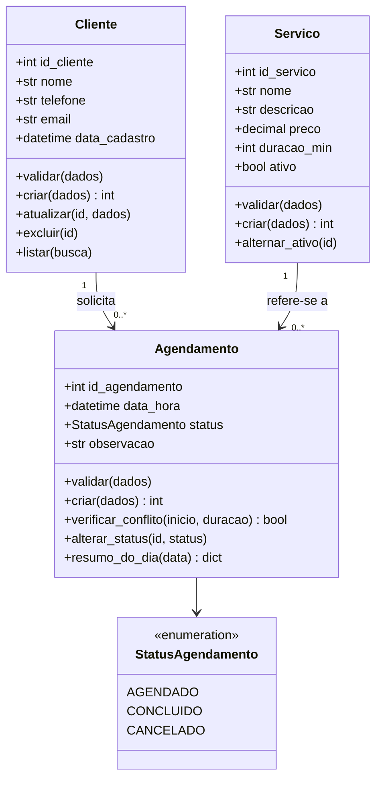
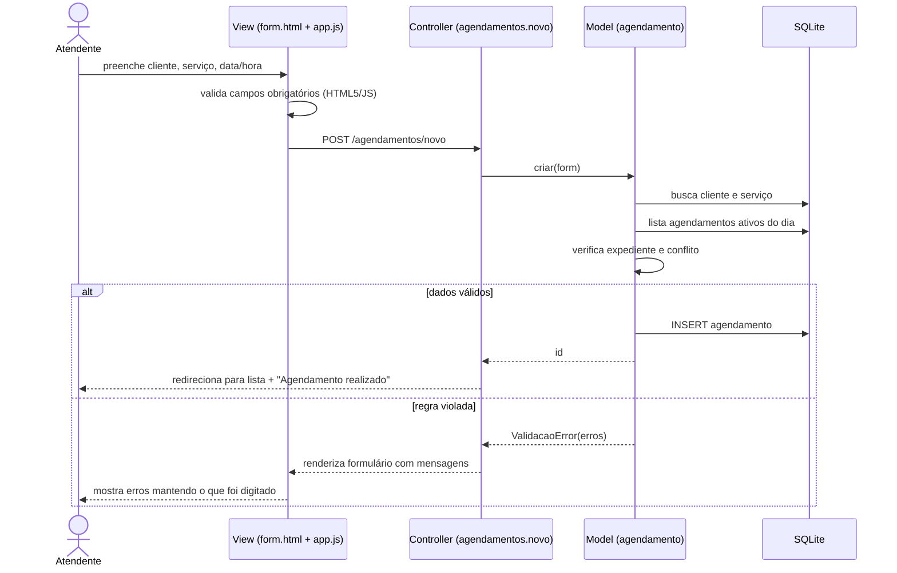
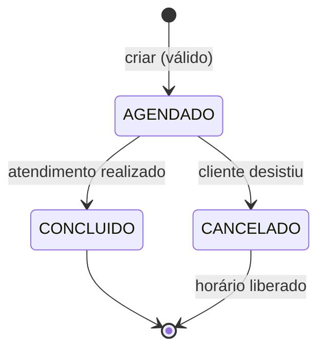

# 3. Modelagem UML (revisada)

> Os diagramas estão em Mermaid: o GitHub os desenha automaticamente ao abrir este arquivo.

## 3.1 Diagrama de classes (domínio e persistência)

## 3.2 Diagrama de sequência – Agendar atendimento

## 3.3 Diagrama de atividades – Ciclo de vida do agendamento

## 3.4 Melhorias aplicadas em relação à PIT I

- Classe `StatusAgendamento` transformada em enumeração (antes era texto livre).
- Incluído o método `verificar_conflito`, que considera a duração do serviço.
- Atributo `ativo` em `Servico` no lugar da exclusão física.
- Sequência revisada para mostrar a validação em duas camadas (View e Model).
