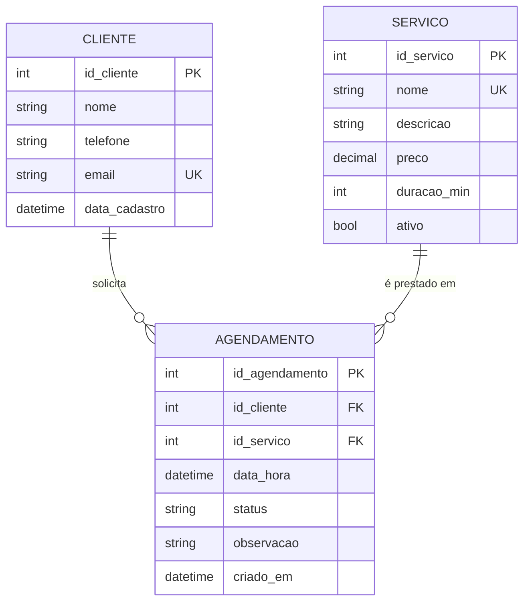

# 4. Projeto de banco de dados

## 4.1 Projeto conceitual (DER)

## 4.2 Projeto lógico (normalizado)

- **CLIENTE** (<u>id_cliente</u>, nome, telefone, email, data_cadastro)
- **SERVICO** (<u>id_servico</u>, nome, descricao, preco, duracao_min, ativo)
- **AGENDAMENTO** (<u>id_agendamento</u>, *id_cliente* → CLIENTE, *id_servico* → SERVICO, data_hora, status, observacao, criado_em)

Verificação das formas normais:

| Forma normal | Situação |
|---|---|
| 1FN | Todos os atributos são atômicos (sem listas ou grupos repetidos). |
| 2FN | Todas as chaves primárias são simples, então não há dependência parcial. |
| 3FN | Não há dependência transitiva: preço e duração ficam em SERVICO, e não são copiados para AGENDAMENTO. |

> Decisão de projeto: o preço **não** é copiado para o agendamento. Se no futuro for preciso
> manter o preço histórico, criar a coluna `valor_cobrado` em AGENDAMENTO (desnormalização consciente).

## 4.3 Projeto físico

O script completo está em [`database/schema.sql`](../../database/schema.sql). Resumo:

- SGBD: **SQLite 3** (arquivo `instance/agendafacil.db`), escolhido por não precisar de servidor e por
  ser compatível com MySQL/PostgreSQL com ajustes mínimos.
- Integridade referencial: `FOREIGN KEY ... ON DELETE RESTRICT` e `PRAGMA foreign_keys = ON`.
- Restrições de domínio com `CHECK` (preço > 0, duração 5–480, status em lista fechada).
- Índices: `idx_agendamento_data` (consultas por dia) e `idx_agendamento_cliente`.

## 4.4 Dicionário de dados

### Tabela `cliente`

| Coluna | Tipo | Nulo | Chave | Domínio / Regra | Descrição |
|---|---|---|---|---|---|
| id_cliente | INTEGER | Não | PK | Autoincremento | Identificador do cliente |
| nome | VARCHAR(100) | Não | | 3 a 100 caracteres | Nome completo |
| telefone | VARCHAR(15) | Não | | (DD) 9XXXX-XXXX | Telefone de contato |
| email | VARCHAR(120) | Sim | UK | Formato de e-mail, único | E-mail do cliente |
| data_cadastro | TEXT (datetime) | Não | | Padrão: data/hora atual | Momento do cadastro |

### Tabela `servico`

| Coluna | Tipo | Nulo | Chave | Domínio / Regra | Descrição |
|---|---|---|---|---|---|
| id_servico | INTEGER | Não | PK | Autoincremento | Identificador do serviço |
| nome | VARCHAR(80) | Não | UK | Mín. 3 caracteres, único | Nome do serviço |
| descricao | VARCHAR(255) | Sim | | | Detalhes do serviço |
| preco | NUMERIC(10,2) | Não | | > 0 | Valor em reais |
| duracao_min | INTEGER | Não | | 5 a 480 | Duração em minutos |
| ativo | INTEGER | Não | | 0 = inativo, 1 = ativo (padrão 1) | Disponível para agendar |

### Tabela `agendamento`

| Coluna | Tipo | Nulo | Chave | Domínio / Regra | Descrição |
|---|---|---|---|---|---|
| id_agendamento | INTEGER | Não | PK | Autoincremento | Identificador |
| id_cliente | INTEGER | Não | FK → cliente | Cliente existente | Quem será atendido |
| id_servico | INTEGER | Não | FK → servico | Serviço ativo no momento do agendamento | O que será feito |
| data_hora | TEXT | Não | Índice | AAAA-MM-DD HH:MM, futura, seg–sáb, 08–18h | Início do atendimento |
| status | VARCHAR(10) | Não | | AGENDADO, CONCLUIDO, CANCELADO | Situação |
| observacao | VARCHAR(255) | Sim | | | Observações livres |
| criado_em | TEXT (datetime) | Não | | Padrão: data/hora atual | Auditoria |
