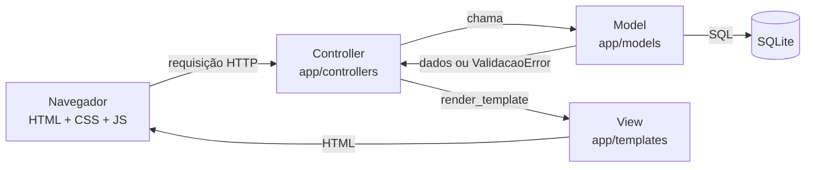

# 5. Arquitetura – padrão MVC

| Camada | Pasta | Responsabilidade | Exemplo |
|---|---|---|---|
| **Model** | `app/models/` | Regras de negócio, validação e acesso ao banco | `agendamento.verificar_conflito()` |
| **View** | `app/templates/`, `app/static/` | Apresentação; não contém regra de negócio | `agendamentos/form.html` |
| **Controller** | `app/controllers/` | Recebe a requisição, chama o Model e escolhe a View | `agendamentos.novo()` |

## Tratamento de erros

- Erros de regra de negócio geram `ValidacaoError` no Model; o Controller transforma cada um em mensagem
  (`flash`) e reexibe o formulário **mantendo o que o usuário digitou**.
- Validação também no navegador (atributos HTML5 + `app.js`), para dar retorno imediato. O servidor sempre
  valida de novo, porque a validação do front pode ser contornada.
- Páginas 404 e 500 personalizadas (`templates/erro.html`).
- Consultas SQL sempre parametrizadas (`?`), o que evita SQL Injection.
- Ações destrutivas (excluir, cancelar) usam `POST` e pedem confirmação.

## Decisões técnicas

| Decisão | Justificativa |
|---|---|
| Flask em vez de Django | Projeto pequeno; deixa o MVC explícito e didático |
| SQL puro (`sqlite3`) em vez de ORM | Mostra o projeto físico e o SQL; menos dependências |
| Sem framework de front-end | O escopo não exige; o JS faz apenas validação, máscara e menu |
| Factory `create_app()` | Permite que os testes usem um banco isolado e temporário |
