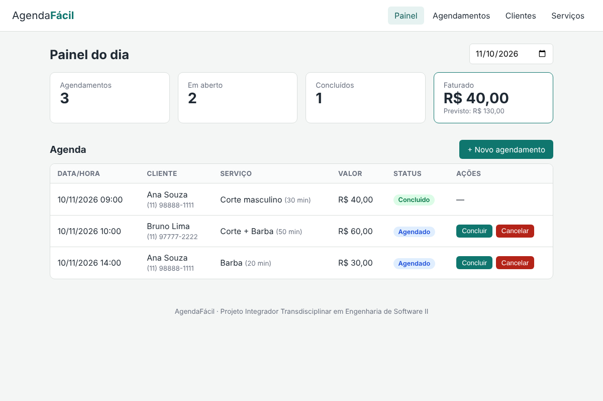
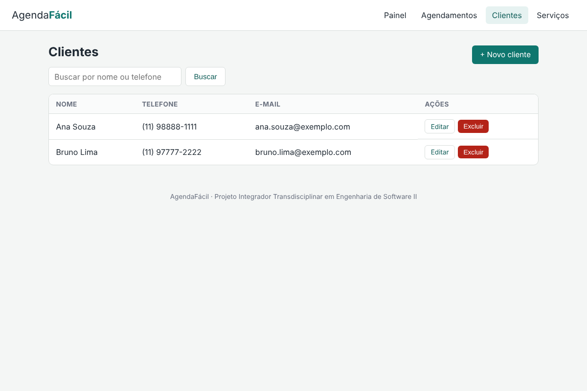
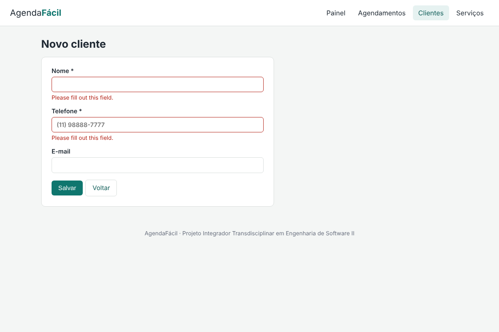
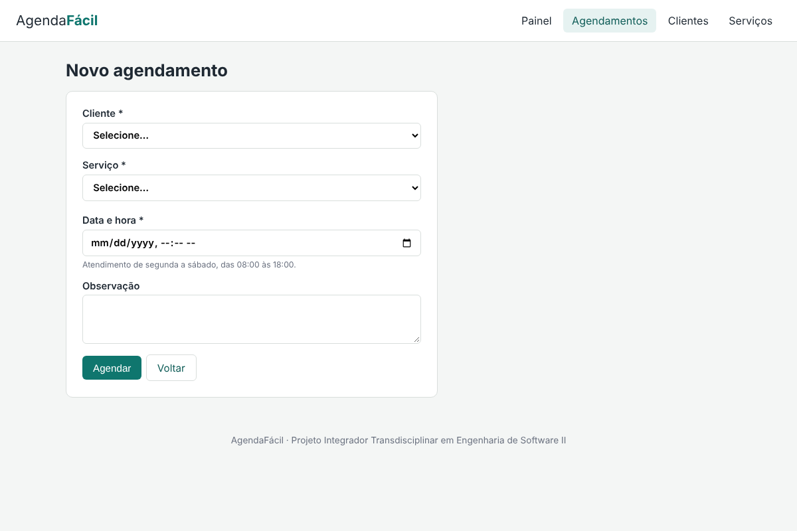
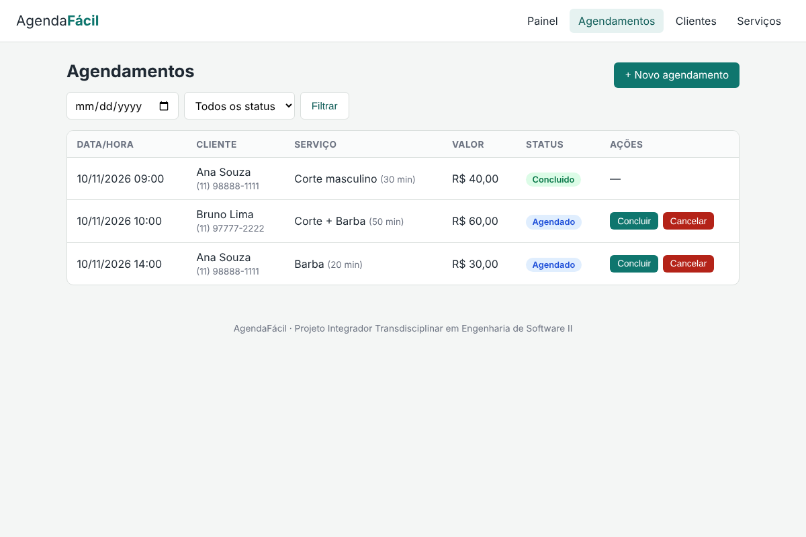
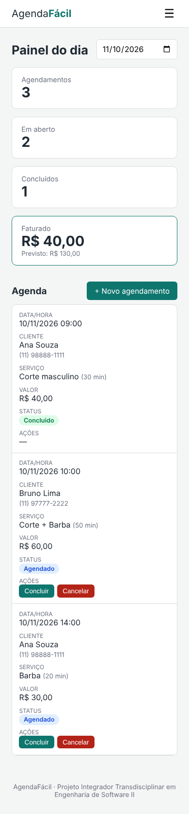

# 6. Manual de uso

## Instalação

Veja a seção "Como executar" no [README](../../README.md). Depois, acesse http://127.0.0.1:5000.

## 6.1 Painel do dia

Mostra os agendamentos da data escolhida e os indicadores: total, em aberto, concluídos, valor já
faturado (concluídos) e valor previsto (concluídos + em aberto). Troque a data no campo do canto superior.

## 6.2 Cadastrar cliente

Menu **Clientes → + Novo cliente**. Preencha nome e telefone (a máscara é aplicada ao digitar). O e-mail
é opcional. Use o campo de busca para localizar por nome ou telefone.

Se algum campo estiver errado, o sistema destaca o campo e explica o problema:

## 6.3 Cadastrar serviço

Menu **Serviços → + Novo serviço**: nome, preço (aceita vírgula) e duração em minutos.
Para tirar um serviço de uso sem perder o histórico, clique em **Desativar**.

## 6.4 Agendar

Menu **Agendamentos → + Novo agendamento** (ou pelo botão do painel).

O sistema recusa e explica quando:

- a data/hora já passou;
- é domingo ou fora do horário das 08:00 às 18:00 (o serviço precisa terminar até 18:00);
- o horário se sobrepõe a outro agendamento em aberto.

## 6.5 Concluir ou cancelar

Na lista de agendamentos ou no painel, use **Concluir** (atendimento feito) ou **Cancelar** (o horário
fica livre de novo). Use os filtros de data e status para encontrar agendamentos.

## 6.6 No celular

O menu vira o botão ☰ e as tabelas viram cartões.
